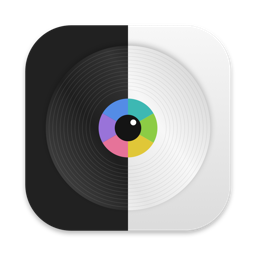
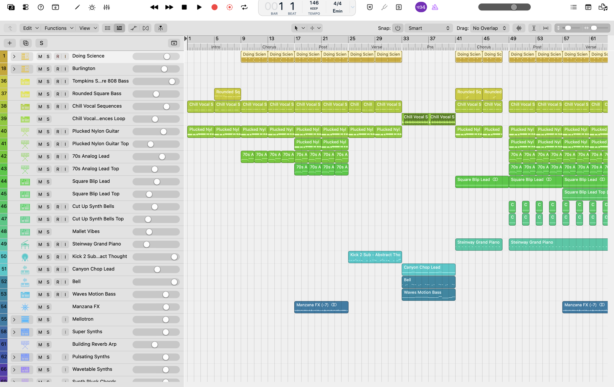
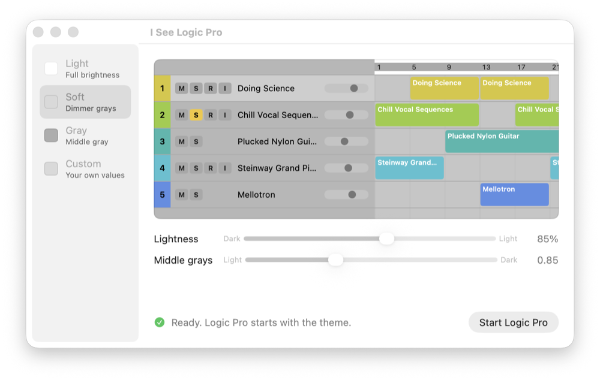
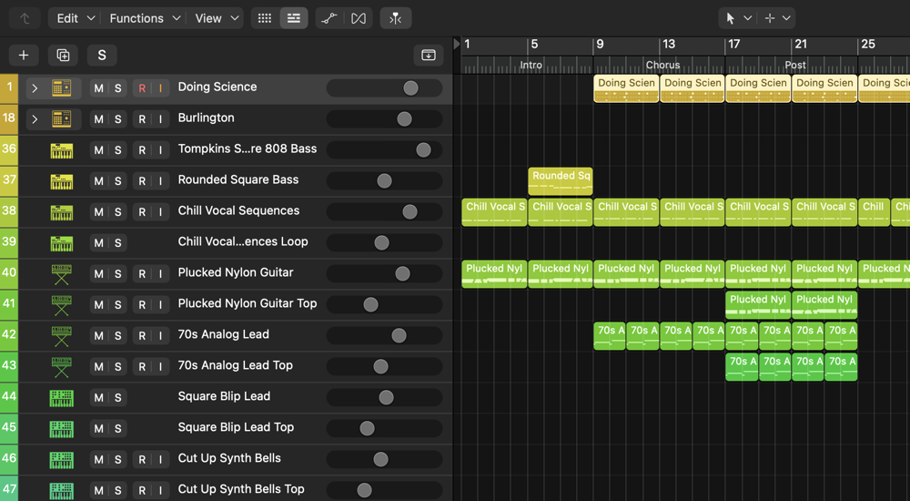
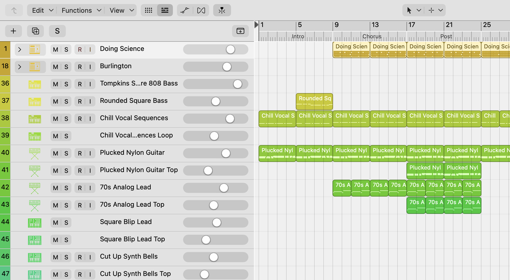
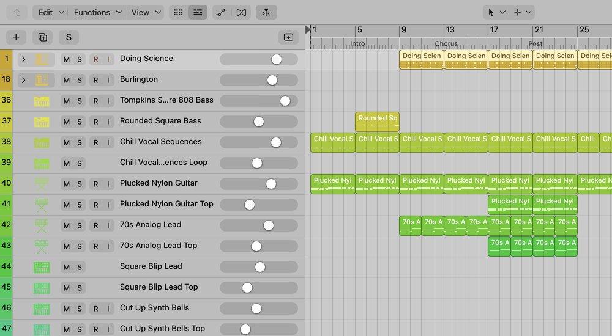
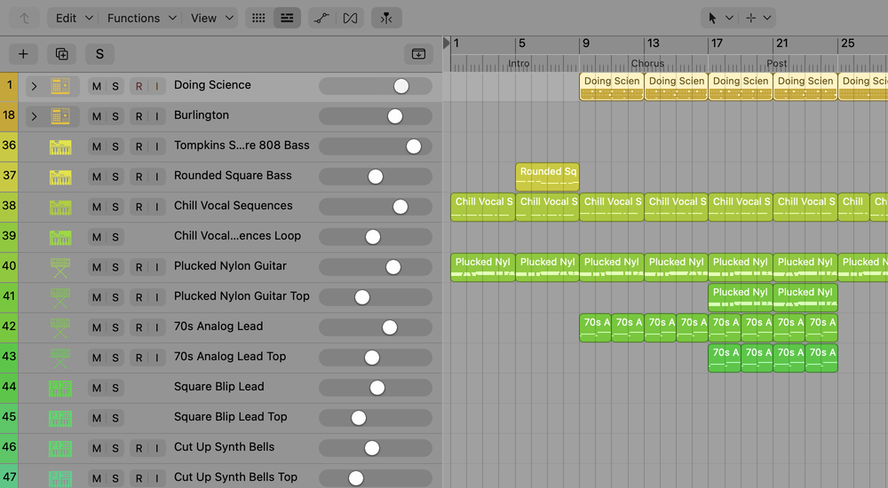

# I See Logic Pro



A customizable light theme for Logic Pro 13. Logic Pro has only a dark interface. This project changes its colors to light colors while Logic Pro runs.

The theme is a small library that Logic Pro loads at launch. It changes nothing in the Logic Pro app or on disk. If you start Logic Pro from the Dock, you get the normal dark interface. A small launcher app starts Logic Pro with the theme and lets you set the brightness.



This project is a prototype. It is not from Apple, and Apple does not support it.

## Requirements

- Logic Pro 13.0 (build 7801). Other versions are not tested.
- A Mac with Apple silicon. The library is built for arm64 only.
- macOS 26. Other versions are not tested.

## Install

1. Download the zip file of the latest version from the [Releases page](https://github.com/karlingen/i-see-logic-pro/releases/latest).
2. Open the zip file. Finder unpacks `I See Logic Pro.app`.
3. Move `I See Logic Pro.app` to your Applications folder.
4. Open the app. macOS shows a warning that Apple did not check the app. Close the warning.
5. Open System Settings, then open Privacy & Security.
6. Scroll down to Security. Find the message about "I See Logic Pro", and click Open Anyway.
7. Enter your password, and click Open Anyway again.

You do these steps only once. After that, the app opens as usual.

macOS shows the warning because Apple did not notarize the app. Notarization is an Apple check of an app, and it needs a paid Apple Developer account. This project does not have one. The source code of the app is in this repository, so you can read it or build the app yourself.

If you prefer a terminal, this command removes the download flag, and macOS then opens the app with no warning:

```sh
xattr -dr com.apple.quarantine "/Applications/I See Logic Pro.app"
```

The theme library inside the app also has the download flag. When you open the app, the app removes the flag from its own library. Without this step, macOS shows a second warning at the start of Logic Pro.

## Build from source

You need the Xcode Command Line Tools. If you do not have them, run `xcode-select --install`.

1. Clone this repository.
2. Build the launcher app and the theme library:

   ```sh
   app/build.sh
   ```

3. Optional: move `app/I See Logic Pro.app` to your Applications folder.

The build writes `theme/light-theme.dylib` and copies it into `app/I See Logic Pro.app`. It signs both for your Mac only. A Mac does not show a warning for an app that it built itself.

## Use

1. Quit Logic Pro.
2. Open `I See Logic Pro.app`.
3. Select a preset in the sidebar, or move the sliders.
4. Click Start Logic Pro.

The app starts Logic Pro with the theme, and then it quits. The theme loads only at launch, so a change takes effect the next time that you start Logic Pro.

The first launch with the theme takes about one second longer. The theme then reads the color names from your copy of Logic Pro and keeps them in a cache. The next launches use the cache.



The preview in the app shows some Logic Pro tracks with the current values. The app paints it with the same gray rule as the theme, so it is close to what Logic Pro shows. If Logic Pro is open or if Logic Pro changed after the build, the status line at the bottom tells you what to do.

## Change the brightness

You decide how light the theme is. A white interface is good in a bright room, but many people find it too bright for long sessions. You can make all the surfaces darker and keep the text black, or select a point between the two.

The theme changes every gray of Logic Pro with one rule. The darkest stock gray becomes the lightness value that you set. The lighter stock grays become darker grays, down to black for white text. Track colors and region colors do not change. Because one rule controls all the grays, two values control the whole interface.

| Stock Logic Pro | Light |
| --- | --- |
|  |  |
| Soft | Gray |
|  |  |

The app has these controls:

| Control | Range | Effect |
| --- | --- | --- |
| Lightness | 0.65 to 1 | The lightest gray. A lower value gives a darker interface. |
| Middle grays | 0.5 to 1.5 | The curve between dark and light grays. A higher value makes the middle grays darker. |

The presets are Light (1 and 0.75), Soft (0.85 and 0.85) and Gray (0.68 and 1). If you move a slider, the app selects Custom and keeps your values. The app stores them, and the theme uses them each time that you start Logic Pro with the app or with `launch.sh`.

Values below 0.65 are not allowed, because black text then becomes hard to read. At 0.65, black text on the lightest gray has a contrast of about 5.6:1.

## Use from a terminal

You can also start Logic Pro with the theme from a terminal:

```sh
theme/launch.sh
```

To open projects at the same time, add their paths:

```sh
theme/launch.sh ~/Music/Logic/MySong.logicx
```

If Logic Pro is open, `launch.sh` stops and tells you to quit Logic Pro first. `launch.sh` uses the settings of the app. Two environment variables override them for one launch:

```sh
LP_SURFACE_MAX=0.85 LP_GAMMA=0.85 theme/launch.sh
```

`LP_SURFACE_MAX` is the lightness, and `LP_GAMMA` is the middle grays value. To change the stored settings without the app, use `defaults`:

```sh
defaults write io.github.karlingen.i-see-logic-pro surfaceMax -float 0.85
```

## After a Logic Pro update

The theme reads the color names of the new Logic Pro version at the first launch. You do not have to do anything for the colors.

An update can also change the internal functions that the theme uses. Each version of the app was tested with one build of Logic Pro. If your build is different, the status line of the app tells you, and some parts of the interface can stay dark. Look for a newer version on the Releases page. If there is none, open an issue with your Logic Pro version.

## Remove

1. Delete `I See Logic Pro.app`. If you built it from source, delete the repository folder too.
2. Delete the stored settings and the color cache:

   ```sh
   defaults delete io.github.karlingen.i-see-logic-pro
   rm -r ~/Library/Caches/io.github.karlingen.i-see-logic-pro
   ```

3. Start Logic Pro from the Dock as usual.

## Known limits

- Some text and controls stay dark or have low contrast. Examples are the automation inspector and the active Mute button in the Mixer.
- The theme depends on internal parts of Logic Pro. An update can make parts of the interface dark again.
- Logic Pro loads the library because Logic Pro 13 allows `DYLD_INSERT_LIBRARIES`. If a future version blocks it, the theme stops working.

## How it works

At launch, `theme/light-theme.m` replaces some AppKit and CoreUI methods. It maps the dark grays of Logic Pro to light grays and keeps saturated colors such as track colors. It also recolors some images and keeps glyphs white on colored buttons. `CLAUDE.md` describes the parts in more detail.
